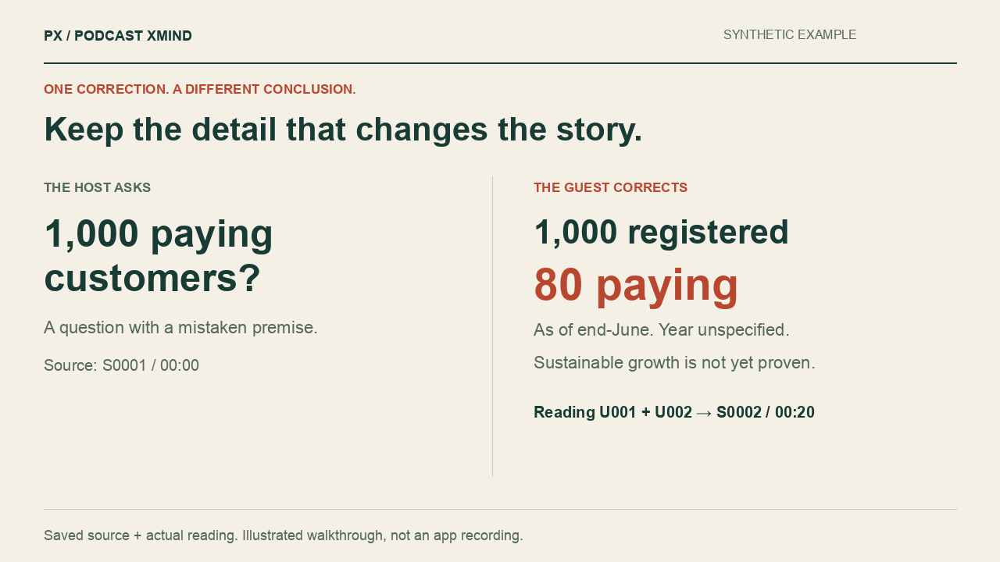

<p align="center"></p>

<h1 align="center">Podcast XMind · 播客导图</h1>

<p align="center"><strong>Your podcast backlog, ready to read.</strong><br>Layered reading that keeps the corrections, reasoning, caveats and useful asides.</p>

<p align="center">
<a href="https://github.com/zachsaws/podcast-xmind/actions/workflows/ci.yml"></a>
<a href="LICENSE"></a>
<a href="https://github.com/zachsaws/podcast-xmind/releases"></a>
</p>

<p align="center"><a href="README.zh-CN.md">简体中文</a> · <a href="#try-it">Install</a> · <a href="examples/synthetic/run/reading.en.md">Read the demo</a> · <a href="https://github.com/zachsaws/podcast-xmind/releases">Download</a></p>

You want to read the episode, not wonder what the summary left out. Give this Agent Skill an accessible podcast link or transcript. It creates a quick scan, a topic-based deep read and evidence you can follow back to the source.

**Scan in 2–3 minutes → choose your depth → check the original words.**

A deep read usually targets 15–25 minutes for a substantive long episode. Short episodes need less; dense ones may need more. There is no fixed word-count cap.

## One detail can change the whole story

<a href="examples/synthetic/run/reading.en.md"></a>

This is original synthetic material, not a real company or a comparative benchmark. You can check every detail against the saved input and actual reading.

| What the source contains | What survives in the reading |
|---|---|
| A host assumes “1,000 paying customers” | The guest corrects it: **1,000 registered accounts; 80 paying organizations, through June** |
| Cost falls from $2 to $0.80 | **Per completed task**, with stable inputs; not per model call |
| A hospital pilot fails | Variable inputs raised costs; the pilot was paused |
| An independent privacy topic | No default training, a 30-day deletion window, and the legal-log exception |
| “Maybe next year” | An uncertain future statement from an unidentified speaker |

[Source](examples/synthetic/excerpt.txt) · [English reading](examples/synthetic/run/reading.en.md) · [Chinese reading](examples/synthetic/run/reading.md) · [Ledger](examples/synthetic/run/ledger.json) · [Audit](examples/synthetic/run/audit.json)

<details>
<summary>Watch the illustrated evidence walkthrough</summary>


An illustrated walkthrough of saved artifacts, not a live application recording.

</details>

## Try it

**Requires a skill-capable agent; helper scripts use Python 3.10+ and its standard library.** Your agent supplies the model and available browsing/transcription tools. No project API key or hosted service is required.

```sh
git clone https://github.com/zachsaws/podcast-xmind.git
cd podcast-xmind
```

Choose **one** installation route:

| Your environment | Install | Invoke |
|---|---|---|
| ChatGPT desktop plugin | `python3 scripts/install_plugin.py` | After restarting, look for **播客导图** under Plugins in the `@` menu |
| Codex standalone skill | `python3 scripts/install.py --agent codex` | `$podcast-xmind <link or file>` |
| Claude Code skill folder | `python3 scripts/install.py --agent claude` | `/podcast-xmind <link or file>` |

```text
$podcast-xmind <episode link or transcript file>
```

Inspect it first: [SKILL.md](skills/podcast-xmind/SKILL.md) · [Complete example](examples/synthetic/run/reading.en.md).

**Compatibility:** Codex/Work execution and local desktop plugin installation have been verified. Post-install Chat picker visibility and live Claude Code execution remain unverified. Copying a local skill does not install a web plugin. [Full compatibility notes](docs/compatibility.md) · [Manual Chat fallback](docs/chat-fallback.md)

## Three layers, one trail back to the source

| Layer | What you get |
|---|---|
| **Scan** | Useful questions, principal answers, the caveat that matters and a topic map |
| **Deep read** | Reasoning, material numbers, concrete examples, counterarguments and independent topics |
| **Evidence** | Source-language excerpts, speaker labels, actual cue times or segment locations, and unresolved uncertainty |

Behind the reading: **source → chunked extraction → information ledger → topic-based prose → two-way review**. Repeated wording can merge. Distinct arguments and exceptions keep their place.

For a real-source example, read [NASA's *Passing Down Knowledge* → Chinese deep reading](examples/nasa/run/reading.md). It retains model limitations, learning through independent analysis and the personal photo aside. [Acquisition record](examples/nasa/README.md) · [Evaluation evidence](docs/evaluation.md)

## What the tools check

The offline normalizer supports **TXT/MD, SRT, VTT and segment JSON**. It keeps original bytes, source positions and actual cue times. The audit flags missing important ledger units, unmatched excerpts, speaker-label mismatches and inconsistent accounting.

```sh
python3 -m unittest discover -s tests -v
python3 scripts/verify_examples.py
```

CI runs on Python 3.10, 3.12 and 3.13. The example verifier reconstructs normalized segments from the retained source and audits the saved readings. [CLI commands and data contract](skills/podcast-xmind/references/ledger-contract.md)

**A structural pass does not prove complete extraction, truth, translation quality or audio fidelity.** Semantic review still goes back to the original. [What was actually evaluated](docs/evaluation.md)

## Questions before you start

<details>
<summary>Can I give it any podcast link?</summary>

A link starts discovery; it does not guarantee a full transcript. Publisher access, login, region, captions and host tools can limit retrieval. Notes-only or excerpts produce visibly partial reading. The bundled CLI does not download episodes or transcribe audio.

</details>

<details>
<summary>Does it create native .xmind files?</summary>

Current output is Markdown deep reading with a JSON evidence ledger. Native `.xmind` export is not included. Podcast XMind is an independent project, not affiliated with Xmind.

</details>

<details>
<summary>Where do my files go?</summary>

The bundled helpers run locally and contain no telemetry, cloud uploads or model API calls. The host agent and any transcription service operate under their own terms. Keep private run material in `runs/` or your chosen private directory.

</details>

## Help make it harder to lose a good idea

The most useful contribution is a specific omission: a shareable source span, the actual output and why the missing detail changes the reader's understanding.

[Report a reading issue](https://github.com/zachsaws/podcast-xmind/issues/new?template=omission.md) · [Request an improvement](https://github.com/zachsaws/podcast-xmind/issues/new?template=feature.yml) · [Contribute](CONTRIBUTING.md) · [Roadmap](docs/roadmap.md)

If this helps you get through your backlog, **star the repo** to find it again and share an example others can inspect.

Inspired by the fact-ledger and quote-checking ideas in [orange2ai/podcast-to-article](https://github.com/orange2ai/podcast-to-article). Independently implemented for reading retention rather than a single publishable article. [Design notes](docs/design-notes.md) · [MIT](LICENSE) · [Source credits](NOTICE.md)
